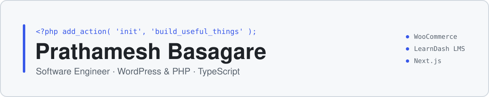

<picture>
  <source media="(prefers-color-scheme: dark)" srcset="assets/banner-dark.svg">
  
</picture>

  <samp>
    <a href="https://www.linkedin.com/in/prathameshbasagare/">linkedin</a> ·
    <a href="https://profiles.wordpress.org/curiouswpdev/">wordpress.org</a> ·
    <a href="#-things-ive-built">projects</a> ·
    <a href="#-competitive-programming">competitive programming</a>
  </samp>

I'm an Associate Software Engineer at **[WisdmLabs](https://wisdmlabs.com)**, where I've spent the last two years building and debugging WordPress plugins, mostly around **WooCommerce** and **LearnDash LMS**. Outside work I publish free WordPress plugins and build TypeScript apps, usually to fix a problem I ran into myself.

## 🔨 Things I've built

<table>
  <tr>
    <td width="50%" valign="top">
      <!--  -->
      <h3><a href="https://github.com/prathameshbasagare/listing-importer-for-hivepress">Listonix</a></h3>
      CSV importer and exporter for HivePress directory sites. It resumes crashed imports from the exact row and never duplicates media.
        
      <code>PHP</code> <code>WordPress</code> <code>HivePress</code>
        
      <a href="https://wordpress.org/plugins/listonix-listing-importer-for-hivepress/">WordPress.org</a> · <a href="https://github.com/prathameshbasagare/listing-importer-for-hivepress">Source</a>
    </td>
    <td width="50%" valign="top">
      <!--  -->
      <h3><a href="https://github.com/prathameshbasagare/fadewatch-abandoned-closed-add-on-checker">FadeWatch</a></h3>
      Flags installed plugins that were closed on WordPress.org (and why), haven't had a release in years, or can't be checked at all.
        
      <code>PHP</code> <code>WP-Cron</code> <code>Site Health API</code>
        
      <a href="https://wordpress.org/plugins/fadewatch-abandoned-closed-plugin-checker/">WordPress.org</a> · <a href="https://github.com/prathameshbasagare/fadewatch-abandoned-closed-add-on-checker">Source</a>
    </td>
  </tr>
  <tr>
    <td width="50%" valign="top">
      <!--  -->
      <h3><a href="https://github.com/prathameshbasagare/listhop-admin-previous-next">Listhop</a></h3>
      Previous, Next and <b>Save&nbsp;&amp;&nbsp;Next</b> buttons on admin edit screens. They follow the filtered, sorted list you came from, including WooCommerce orders.
        
      <code>PHP</code> <code>WooCommerce HPOS</code> <code>JavaScript</code>
        
      <a href="https://github.com/prathameshbasagare/listhop-admin-previous-next">Source</a>
    </td>
    <td width="50%" valign="top">
      <!--  -->
      <h3><a href="https://github.com/prathameshbasagare/Adaptive-UI-Search">Adaptive UI Search</a></h3>
      A chat app where the model picks <i>how</i> to answer. It returns structured JSON that's rendered as one of 25 components: charts, tables, timelines, quizzes and more.
        
      <code>TypeScript</code> <code>Next.js</code> <code>Gemini API</code> <code>Chart.js</code>
        
      <a href="https://adaptive-ui-search.vercel.app">Live demo</a> · <a href="https://github.com/prathameshbasagare/Adaptive-UI-Search">Source</a>
    </td>
  </tr>
</table>

<b>How they work under the hood</b>

**Listonix**
- Imports in AJAX batches and saves the file byte offset after every row, so a timed-out import resumes where it stopped.
- Reads file headers to detect the real type of extensionless CDN images (Unsplash, Google Places, S3), and reuses existing media by source-URL hash.
- Hardened against CSRF, SSRF and CSV formula injection; supports create, update and upsert modes, galleries and custom attributes.

**FadeWatch**
- Checks run through WP-Cron in time-boxed batches. Admin screens only read stored results and never make HTTP requests.
- Closed and missing plugins both return HTTP 404 from WordPress.org, so it tells them apart by the response body. It also guards against slug collisions and never lets a failed request overwrite a good result.
- Opt-in before any request is sent; adds Site Health tests, change-only email alerts and multisite support.

**Listhop**
- Finds the neighbouring item with one indexed `LIMIT 1` keyset query per direction when the sort allows it, and falls back to a cached ID window otherwise.
- Supports HPOS and legacy WooCommerce order storage, the block editor and the classic editor.

**Adaptive UI Search**
- Next.js App Router route handler on the server; Zustand manages chat and tab state on the client.
- A ranked model fallback chain across Gemini / Gemma and OpenRouter, so a rate-limited model doesn't fail the request.
- A repair pass extracts and fixes malformed JSON from smaller models before it reaches the renderer.

<b>More projects</b>

 

| Project | What it is | Stack |
| :-- | :-- | :-- |
| [WebEngage](https://github.com/prathameshbasagare/WebEngagementSite) | Web analytics platform (final-year project): a JavaScript SDK tracks page views, clicks, inputs and form submissions, and a React dashboard charts them | MongoDB · Express · React · Node.js |
| [SFML Motion & Collisions](https://github.com/prathameshbasagare/SFML-Motion-and-collisions-in-CPP) | Config-driven C++ demo with a single polymorphic shape class, per-shape velocity and wall collisions | C++17 · SFML · ImGui |

### 📦 On WordPress.org

<!-- WPORG:START -->
| Plugin | Version | Tested up to | Active installs | Downloads | Last updated |
| :-- | :-: | :-: | :-: | :-: | :-: |
| [FadeWatch – Abandoned & Closed Plugin Checker](https://wordpress.org/plugins/fadewatch-abandoned-closed-plugin-checker/) | 1.0.3 | 7.1.4 | <10 | 315 | 2026-11-06 |
| [Listonix: Listing Importer for HivePress](https://wordpress.org/plugins/listonix-listing-importer-for-hivepress/) | 1.0.2 | 7.1.4 | <10 | 313 | 2026-10-30 |
<!-- WPORG:END -->

Refreshed daily by a GitHub Action from the WordPress.org Plugins API.

## 💼 At work

I build custom plugins and client features on WordPress hooks, filters, the REST API and WP-CLI. Most of that work is WooCommerce and LearnDash workflows, along with Figma-to-Gutenberg/Elementor builds and query performance work.

<b>Production bugs I've chased</b>

 

- An intermittent WooCommerce checkout that created **duplicate orders**.
- A **memory-exhaustion bug in LearnDash 4.23.0**, triggered by adding a trashed quiz to a course. I tracked it down and reported it upstream.
- **Duplicate-username enrollment failures** in LearnDash Group Registration, fixed by adjusting the arguments passed to `wp_insert_user` through a filter.
- Cleanup after a **site compromise**: restoring a tampered template, removing rogue accounts, and working with the host to close the hole.

## 🧰 Tools I use

| | |
| :-- | :-- |
| **Primary** | PHP · WordPress plugin development · WooCommerce · LearnDash · MySQL |
| **Also** | TypeScript · JavaScript · React · Next.js · Node.js / Express · MongoDB |
| **Day to day** | Gutenberg · Elementor · WP-CLI · REST APIs · Git · Linux · Bash |

## 🏆 Competitive programming

Most of my problem-solving practice comes from contests, mainly in C++.

| Platform | Achievement |
| :-- | :-- |
| **Codeforces** | Specialist · rating 1429 · 289 problems solved |
| **CodeChef** | 3★ · rating 1630 |
| **LeetCode** | 459+ problems solved |

## 🌱 Currently

- Getting more of my plugins listed on WordPress.org
- Building LLM-backed tools that return structured output instead of plain text
- Going deeper into WordPress performance: query optimisation, caching and HPOS

---

  Always up for a conversation about web engineering, AI-powered tools, tricky production bugs, or whatever you're building. 
  <b>Reach me on <a href="https://www.linkedin.com/in/prathameshbasagare/">LinkedIn</a>.</b>

